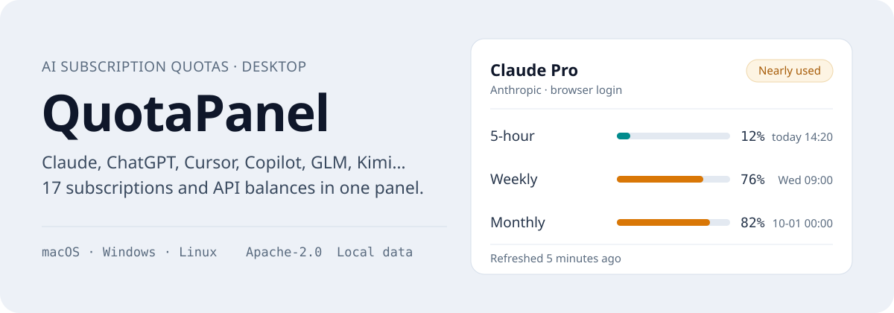
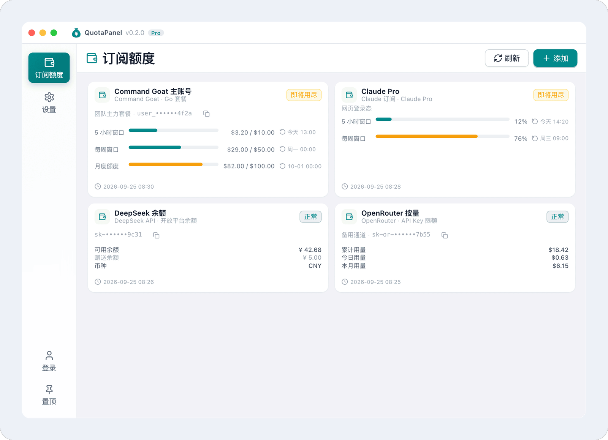
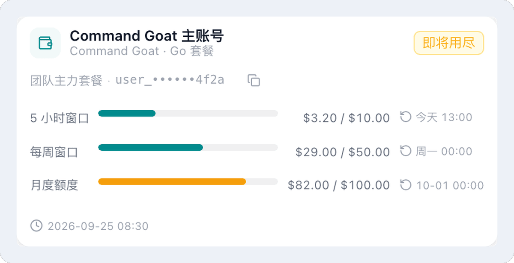
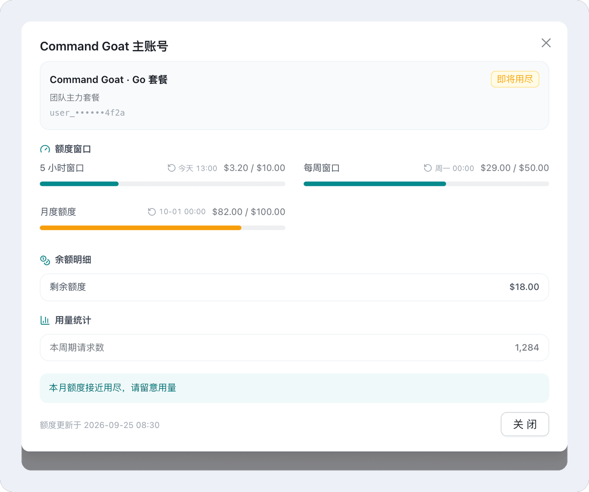
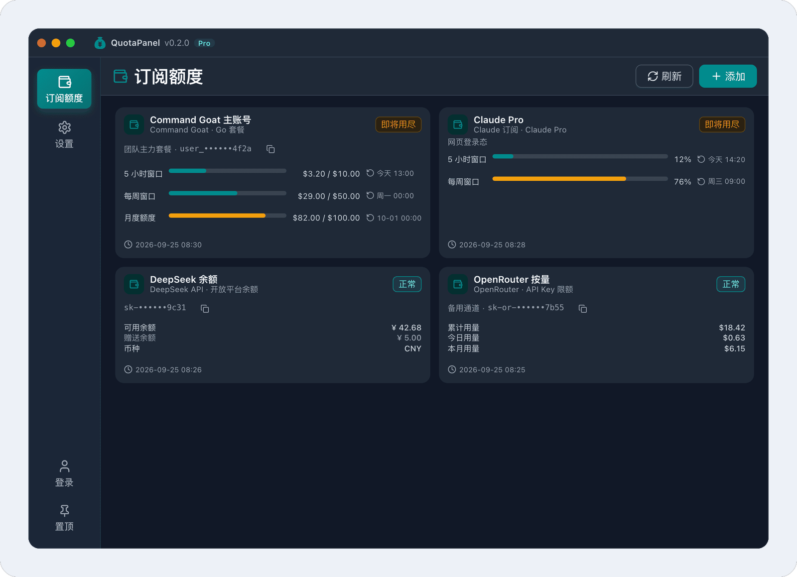
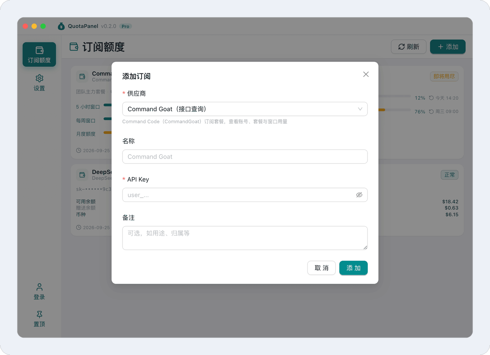
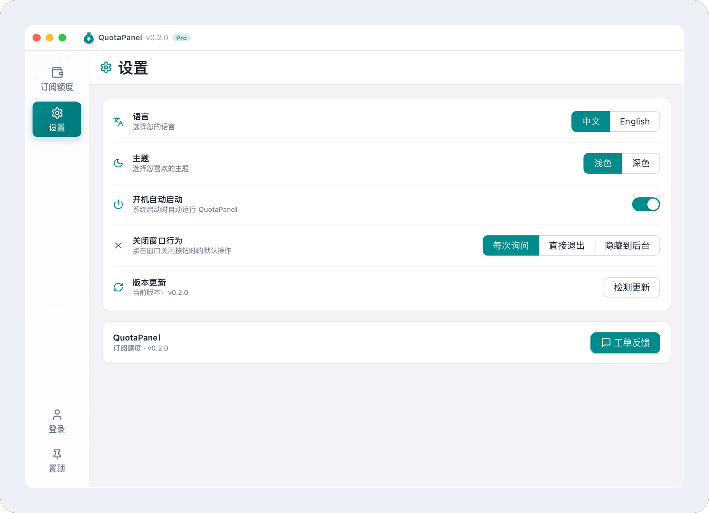

# QuotaPanel

<p align="center">
  
</p>

<p align="center">
  <a href="README.md">中文</a> ·
  <a href="https://open.tecmz.com/quotapanel">Download</a> ·
  <a href="https://github.com/open-tecmz/quotapanel">GitHub</a> ·
  <a href="https://gitee.com/open-tecmz/quotapanel">Gitee</a>
</p>

<p align="center">
  
  
  <a href="https://github.com/open-tecmz/quotapanel"></a>
  <a href="https://gitee.com/open-tecmz/quotapanel"></a>
</p>

Once you pay for more than one AI service, the quota information spreads out: Claude's 5-hour window, Codex's weekly cap, Cursor's billing cycle, DeepSeek and OpenRouter balances, each behind a different dashboard. QuotaPanel pulls those queries into one desktop app, one card per account, showing what you have used, what is left and when it resets.

Account details, API keys and browser sessions stay on your machine. The app queries each provider's endpoint directly; nothing is relayed through a server.

## Screenshots

<p align="center">
  
</p>

<p align="center"><sub>Main screen: one card per account, the bar color follows the status</sub></p>

<p align="center">
  
</p>

<p align="center"><sub>The card itself: quota windows, used / total, next reset</sub></p>

<p align="center">
  
  
</p>

<p align="center"><sub>Left: detail modal · Right: dark theme</sub></p>

<p align="center">
  
  
</p>

<p align="center"><sub>Left: adding an account · Right: settings</sub></p>

## Supported services

17 sources; subscriptions that need a web login open a dedicated browser window, everything else uses an API key.

| Service | Access | What it shows |
|---------|--------|---------------|
| Claude | Browser login | 5-hour and weekly quota windows, reset times |
| ChatGPT / Codex | Browser login | Codex subscription usage window |
| Cursor | Browser login | Usage for the current billing cycle |
| Xiaomi MiMo Token Plan | Browser login | Plan credits, validity and token stats |
| GitHub Copilot | API key | Premium, chat and completion quotas (needs a GitHub token that can reach Copilot's usage endpoint) |
| Z.ai Coding Plan | API key | GLM Coding Plan rolling and weekly usage |
| Kimi Coding Plan | API key | Subscription usage |
| MiniMax Token Plan | API key | Rolling and weekly remaining quota |
| Devin / Windsurf | API key | Daily and weekly quotas plus overage balance |
| Grok CLI | API key | Subscription period quota |
| OpenCode | API key | Go plan 5-hour / weekly / monthly usage |
| OpenDesign | Control key | Design / Coding Plan windows and wallet balance (workspace ID optional; inference API keys cannot read quota) |
| Command Goat | API key | Account, plan and window usage |
| DeepSeek API | API key | Open platform balance |
| Kimi API | API key | Open platform balance |
| OpenRouter | API key | Consumption and limits for the current key |
| OpenAI API | Admin key | Organization API cost over the last 30 days |

All of these are on-site or internal usage endpoints without a stability guarantee: a redesign or a login policy change can break a query. The integration approach and response mappings live in [`docs/quota-research.md`](docs/quota-research.md); usually only the matching provider needs updating.

## Getting started

Download the macOS, Windows or Linux installer from [open.tecmz.com/quotapanel](https://open.tecmz.com/quotapanel) and open it.

Use 「添加」 (Add) in the top right and pick a service. Browser-login subscriptions (Claude, ChatGPT / Codex, Cursor, MiMo) open a dedicated window: sign in once, the session stays on this machine and is removed with the account. For API keys, paste the key and add a workspace or organization where the provider needs one; sensitive values are masked by default and can be copied.

Accounts then refresh every 5 minutes on their own, or on demand with 刷新 (Refresh) for one account or all of them. Day to day:

- Drag the handle in the card's top-left corner to reorder; the order is saved on drop and applies to the menu bar mini panel too
- Click a card for every quota window, balance and usage stat
- 「更多 → 分享」 (More → Share) exports a long image of one card or all of them
- It lives in the macOS menu bar / Windows and Linux tray; on close you can be asked, quit, or hide to background

### Local development

You need Go 1.25+, [Wails v2](https://wails.io/docs/gettingstarted/installation), Node.js 20 and pnpm:

```bash
# Install the Wails CLI and pnpm
go install github.com/wailsapp/wails/v2/cmd/wails@latest
npm install -g pnpm

# Install dependencies, then run in development mode (frontend hot reload)
make install
make dev

# Build the production app (output in build/bin/)
make build

# Build and install to /Applications (macOS)
make build-install
```

Building on Linux also needs the Wails system dependencies (`libgtk-3-dev`, `libwebkit2gtk-4.0-dev` and friends); see the Wails docs. After changing a Go method exposed to the frontend, run `wails generate module` to regenerate the JS bindings.

## Data directory

The first launch creates `~/.quotapanel/` for the config file, a SQLite database and each account's browser session. Set `QUOTAPANEL_DATA_ROOT` to keep it elsewhere; the settings page shows the path in use.

## Project structure

```
quotapanel/
├── main.go              # Wails app config and entry point
├── app*.go              # Methods exposed to the frontend
├── backend/
│   ├── base/            # Database, config, logging, window and platform specifics
│   └── quota/           # Quota providers and the query service
├── frontend/packages/
│   ├── ui/              # Main UI (Vue3 + Ant Design Vue + TailwindCSS)
│   └── quota/           # Quota business module
├── docs/                # Quota source research, auto-update notes
└── Makefile             # Dev, build and release commands
```

## Contributing

- Found a bug or have an idea? Open an [issue](https://github.com/open-tecmz/quotapanel/issues)
- Adding a quota source: implement the `Provider` interface in `backend/quota/provider_*.go` and call `Register`; see [`docs/quota-research.md`](docs/quota-research.md) for the access patterns
- Docs, translations and UI improvements are welcome as PRs; a star helps too

Chat groups (mention "QuotaPanel" when adding us):

<p align="center">
  
  
</p>

<p align="center"><sub>Left: WeChat · Right: QQ</sub></p>

## License

[Apache-2.0](LICENSE). Free to use, modify and ship commercially.
