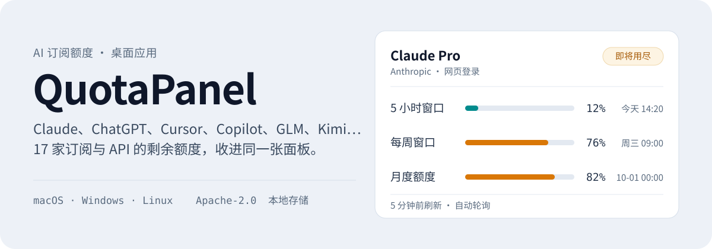
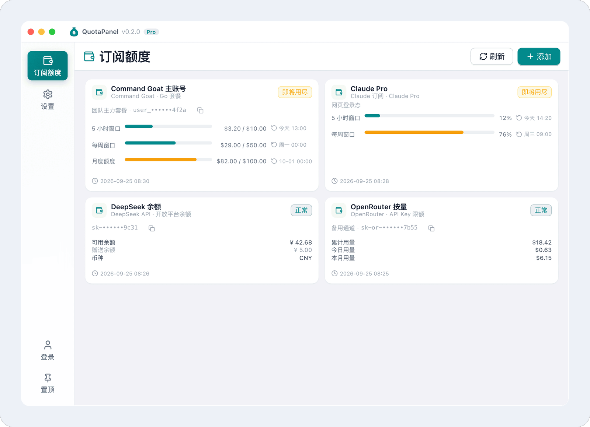
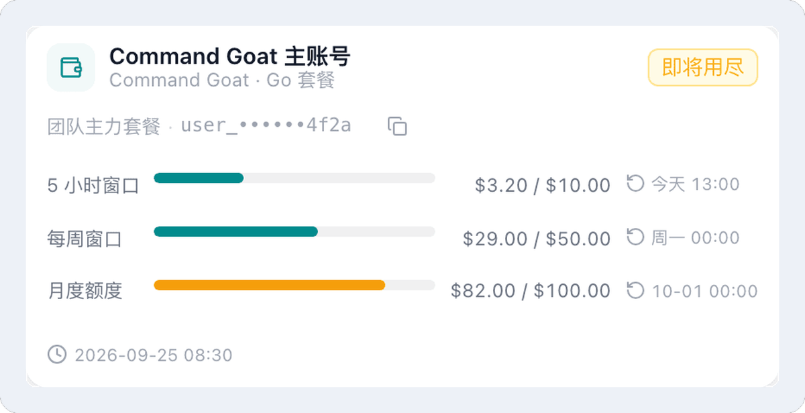
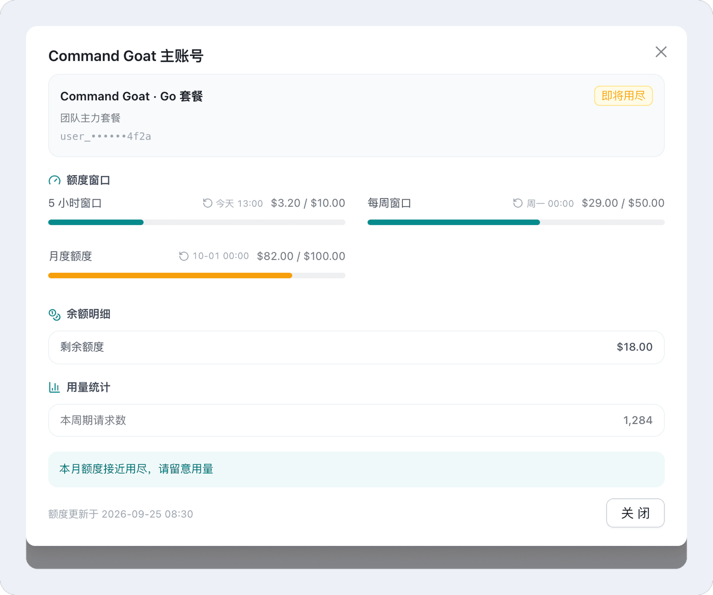
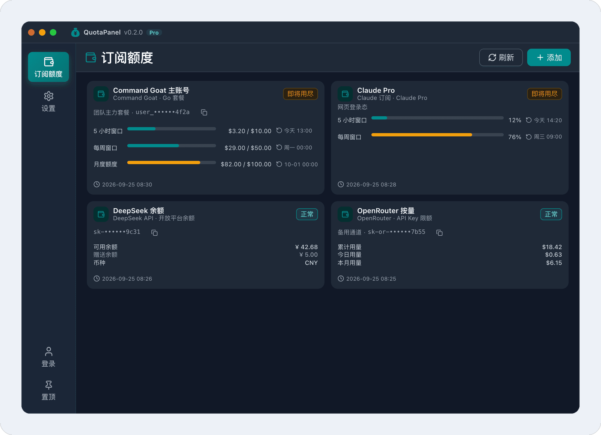
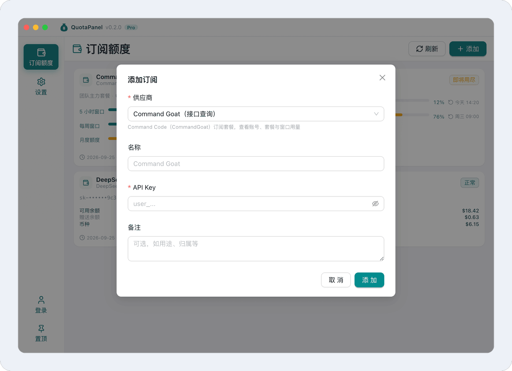
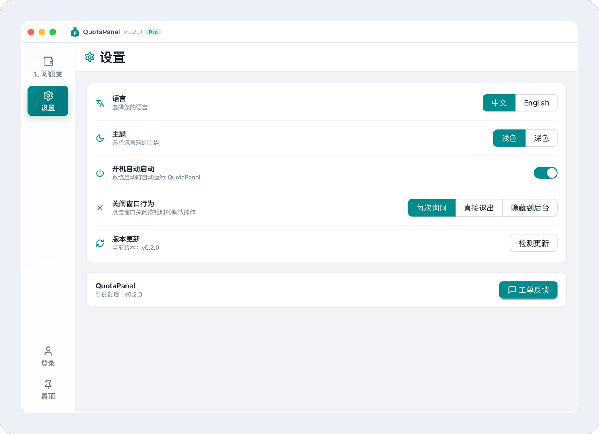

# QuotaPanel

<p align="center">
  
</p>

<p align="center">
  <a href="README.en-US.md">English</a> ·
  <a href="https://open.tecmz.com/quotapanel">下载</a> ·
  <a href="https://github.com/open-tecmz/quotapanel">GitHub</a> ·
  <a href="https://gitee.com/open-tecmz/quotapanel">Gitee</a>
</p>

<p align="center">
  
  
  <a href="https://github.com/open-tecmz/quotapanel"></a>
  <a href="https://gitee.com/open-tecmz/quotapanel"></a>
</p>

同时订几家 AI 服务之后，额度就散在各家控制台里：Claude 的 5 小时窗口、Codex 的每周额度、Cursor 的账单周期、DeepSeek 和 OpenRouter 的余额，各查各的。QuotaPanel 把这些查询收进一个桌面应用，一个账号一张卡片，写清楚用了多少、还剩多少、什么时候重置。

账号信息、API Key 和浏览器登录态都只保存在本机，查询由客户端直接发往各家接口，不经过任何中转。

## 界面

<p align="center">
  
</p>

<p align="center"><sub>主界面：每张卡片对应一个账号，进度条颜色随状态变化</sub></p>

<p align="center">
  
</p>

<p align="center"><sub>卡片本身：额度窗口、已用 / 总额、下次重置时间</sub></p>

<p align="center">
  
  
</p>

<p align="center"><sub>左：详情弹窗 · 右：深色主题</sub></p>

<p align="center">
  
  
</p>

<p align="center"><sub>左：添加账号 · 右：设置</sub></p>

## 支持的服务

17 个来源，接入方式分两类：需要网页登录的走独立浏览器窗口，其余用 API Key。

| 服务 | 接入 | 显示内容 |
|------|------|----------|
| Claude 订阅 | 网页登录 | 5 小时与每周额度窗口、重置时间 |
| ChatGPT / Codex | 网页登录 | Codex 订阅的使用窗口 |
| Cursor | 网页登录 | 当前账单周期的用量 |
| 小米 MiMo Token Plan | 网页登录 | 套餐积分、有效期与 Token 统计 |
| GitHub Copilot | API Key | Premium、对话与补全额度（需可访问 Copilot 用量接口的 GitHub 令牌） |
| Z.ai Coding Plan | API Key | GLM Coding Plan 滚动与每周用量 |
| Kimi Coding Plan | API Key | 订阅用量 |
| MiniMax Token Plan | API Key | 滚动与每周剩余额度 |
| Devin / Windsurf | API Key | 每日、每周额度与超额余额 |
| Grok CLI | API Key | 订阅周期额度 |
| OpenCode | API Key | Go 套餐的 5 小时 / 每周 / 月度用量 |
| OpenDesign | Control Key | Design / Coding Plan 窗口与钱包余额（工作区 ID 可省略；推理 API Key 查不到额度） |
| Command Goat | API Key | 账号、套餐与窗口用量 |
| DeepSeek API | API Key | 开放平台余额 |
| Kimi API | API Key | 开放平台余额 |
| OpenRouter | API Key | 当前 Key 的消费与限额 |
| OpenAI API | Admin Key | 组织近 30 天的 API 费用 |

这些接口都是各家站内或内部用量接口，没有稳定性承诺，平台改版或登录策略调整时可能失效。接入方式与响应映射记录在 [`docs/quota-research.md`](docs/quota-research.md)，改版时只需更新对应的 provider。

## 开始使用

从 [open.tecmz.com/quotapanel](https://open.tecmz.com/quotapanel) 下载 macOS、Windows 或 Linux 安装包，装好直接打开。

点右上角「添加」选择服务。需要网页登录的（Claude、ChatGPT / Codex、Cursor、MiMo）会弹出独立浏览器窗口，登录一次即可，登录态存在本机，删账号时一并清掉。用 Key 的把 Key 粘进去，需要工作区或组织的再补上；敏感值默认脱敏，可一键复制。

添加后的账号每 5 分钟自动查询一次，也可以点「刷新」手动查单个或全部账号。日常操作：

- 按住卡片左上角的手柄拖动可以排序，松手即保存，主界面和菜单栏迷你面板同步生效
- 点卡片打开详情，看全部额度窗口、余额与统计
- 「更多 → 分享」生成单卡或全部卡片的长图，方便贴到群里
- macOS 菜单栏 / Windows、Linux 托盘常驻；关窗时可以选择每次询问、直接退出或隐藏到后台

### 本地开发

需要 Go 1.25+、[Wails v2](https://wails.io/docs/gettingstarted/installation)、Node.js 20 与 pnpm：

```bash
# 安装 Wails CLI 与 pnpm
go install github.com/wailsapp/wails/v2/cmd/wails@latest
npm install -g pnpm

# 安装依赖、启动开发模式（前端热重载）
make install
make dev

# 构建生产版本（产物在 build/bin/）
make build

# 构建并安装到 /Applications（macOS）
make build-install
```

Linux 构建还要装 Wails 的系统依赖（`libgtk-3-dev`、`libwebkit2gtk-4.0-dev` 等），见 Wails 文档。改了 Go 暴露给前端的方法后，执行 `wails generate module` 重新生成 JS 绑定。

## 数据目录

首次启动会创建 `~/.quotapanel/`，放着配置文件、SQLite 数据库和各账号的浏览器会话。要换位置就设置环境变量 `QUOTAPANEL_DATA_ROOT`，设置页会显示当前实际路径。

## 项目结构

```
quotapanel/
├── main.go              # Wails 应用配置与入口
├── app*.go              # 暴露给前端的方法
├── backend/
│   ├── base/            # 基础库：数据库、配置、日志、窗口、平台差异
│   └── quota/           # 额度 provider 与查询服务
├── frontend/packages/
│   ├── ui/              # 主界面（Vue3 + Ant Design Vue + TailwindCSS）
│   └── quota/           # 额度业务模块
├── docs/                # 额度来源调研、自动更新说明
└── Makefile             # 开发、构建与发布命令
```

## 参与贡献

- 发现 Bug 或有建议，提 [Issue](https://github.com/open-tecmz/quotapanel/issues)
- 新增额度来源：在 `backend/quota/provider_*.go` 里实现 `Provider` 接口并 `Register`，接入方式可参考 [`docs/quota-research.md`](docs/quota-research.md)
- 文档、翻译、界面改进都欢迎 PR；觉得有用可以点个 Star

交流群（添加好友请备注 "QuotaPanel"）：

<p align="center">
  
  
</p>

<p align="center"><sub>左：微信交流群 · 右：QQ 交流群</sub></p>

## 许可证

[Apache-2.0](LICENSE)，可自由使用、修改和商用。
